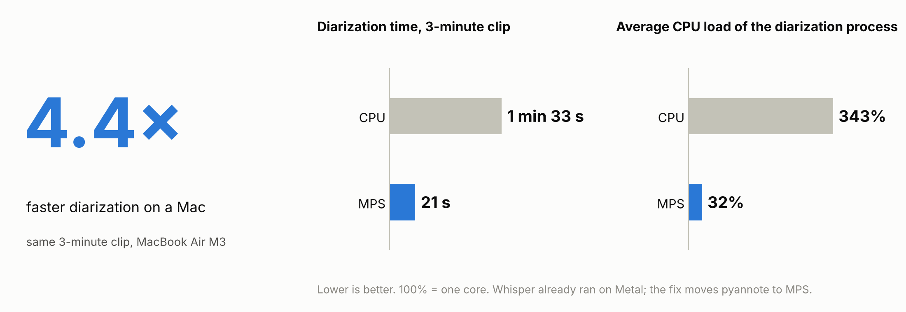

# Diarization 4× faster on a Mac: local meeting transcription on the Apple GPU

A local pipeline that turns meeting recordings into text with timestamps and speaker labels (whisper.cpp + pyannote.audio). Moving pyannote from the CPU to the Apple GPU (MPS) cut diarization of the same 3-minute clip from 1 min 33 s to 21 s. Everything runs on the laptop; nothing is uploaded.

[Full case study: diagnosis, measurements and caveats](docs/case-study.md) · [По-русски](README.ru.md)



- **Cause:** Whisper already ran on Metal, but pyannote silently ran on the CPU. One line moved it to the GPU.
- **Result:** 4.4× faster diarization on the 3-minute clip. A 42-minute meeting now takes about 11 minutes end to end (RTF 0.27, see [Performance notes](#performance-notes)).
- **Caveat:** single runs on one machine, no accuracy measurements (see [Limitations](#limitations-and-not-measured)).
- **Stack:** whisper.cpp `ggml-medium` on Metal, pyannote.audio 4.0.7 with `speaker-diarization-community-1` on MPS, a macOS Folder Action that queues files one at a time.

## Why it was slow, and the one-line fix

On the first real meetings, transcription was fast and diarization was not: a 42-minute recording took 2 h 9 min and loaded the laptop heavily; a process snapshot showed diarization holding 233% CPU. MPS was available and Whisper was already using Metal, but nothing in the diarization script moved the pyannote pipeline to the GPU, and PyTorch does not do that by itself.

```python
device = torch.device("mps" if torch.backends.mps.is_available() else "cpu")
pipeline.to(device)
```

`scripts/diarize.py` also loads the WAV into memory once, waits for the GPU with `torch.mps.synchronize()` before reading the timer, and logs the device and the time of each stage. The full diagnosis, including the launch and queue changes made first, is in the [case study](docs/case-study.md#3-the-problem-transcription-is-fast-speaker-labelling-is-not).

## What this pipeline does

```text
Audio file → Audio/ folder → Folder Action (Automator)
→ dialog: 1–20 speakers / auto / Cancel
→ files are processed one at a time
→ FFmpeg → 16 kHz mono WAV
→ whisper.cpp medium (Metal) → text + segments
→ pyannote community-1 (MPS) → who speaks when
→ Transcripts/<name>_diarized.txt
```

| Stage | Tool | Why |
| :---- | :---- | :---- |
| Trigger and queue | Automator Folder Action, shell lock directory | One heavy job at a time; files already processed are skipped |
| Convert | FFmpeg | One input format for the next two stages |
| Transcribe | whisper.cpp `ggml-medium`, `-l auto` | Runs on Metal; the language is detected and nothing is translated |
| Diarize | pyannote.audio `speaker-diarization-community-1` | Runs on MPS; CC BY 4.0 |
| Merge | `scripts/diarize.py` | One speaker per Whisper segment, chosen by largest overlap |

## Hardware requirements

Tested on a MacBook Air M3 (8 cores, 16 GB) with macOS 26. Apple Silicon is needed for Metal and MPS. On an Intel Mac, MPS is not available and diarization runs on CPU.

Measured peak memory of the diarization process on MPS: 1.0 GiB on a 3-minute clip and 1.2 GiB on a 42-minute meeting. At RTF 0.27 on this machine, an hour of audio takes about 16 minutes.

## Setup

Full steps with troubleshooting are in [docs/setup.md](docs/setup.md) (in Russian). The short version:

**1. System tools**

```bash
brew install ffmpeg whisper-cpp python@3.11
mkdir -p ~/whisper-models
curl -L -o ~/whisper-models/ggml-medium.bin \
  https://huggingface.co/ggerganov/whisper.cpp/resolve/main/ggml-medium.bin
which whisper-cli   # the script looks in /opt/homebrew/bin and /usr/local/bin
```

**2. Python environment**

```bash
python3.11 -m venv ~/.venvs/diarization
~/.venvs/diarization/bin/pip install -r requirements.txt
~/.venvs/diarization/bin/python -c "import platform, torch; print(platform.machine(), torch.backends.mps.is_available())"
```

The check must print `arm64 True`. If it prints `x86_64`, the environment runs under Rosetta and MPS will not work.

**3. Access to the diarization model**

The model is gated. Accept the conditions on the `pyannote/speaker-diarization-community-1` page on Hugging Face, create a read token, then log in from the same environment:

```bash
~/.venvs/diarization/bin/hf auth login
```

The first run downloads the weights; after that everything works from the local cache.

**4. Folders and scripts**

```bash
mkdir -p ~/Documents/Meetings/{Audio,Transcripts,scripts}
cp scripts/* ~/Documents/Meetings/scripts/
chmod +x ~/Documents/Meetings/scripts/run_transcription.sh
```

The script expects the model at `~/whisper-models/ggml-medium.bin`, Python at `~/.venvs/diarization/bin/python` and the folders under `~/Documents/Meetings`. Edit the variables at the top of `run_transcription.sh` if yours differ. The speaker dialog and the notifications live in `ask_speakers.applescript` and `notify.applescript`.

**5. Folder Action**

In Automator create a new **Folder Action** for `~/Documents/Meetings/Audio`, add **Run Shell Script** (shell `/bin/zsh`, pass input **as arguments**) and paste this command, which starts the script in the background so the Automator action finishes at once:

```bash
BASE="$HOME/Documents/Meetings"
mkdir -p "$BASE/Transcripts"
/usr/bin/nohup /bin/zsh "$BASE/scripts/run_transcription.sh" "$@" </dev/null >> "$BASE/Transcripts/transcription.log" 2>&1 &
```

Save, then enable folder actions: right-click `Audio` → Services → Folder Actions Setup.

## Usage

Drop an audio file (`m4a`, `mp3`, `wav`, `mp4`, `aac`, `flac`, `ogg`) into `Audio/`. A dialog asks for the number of speakers: a number from 1 to 20, or `auto` if you do not know. Cancel skips the file.

Watch progress in the log:

```bash
tail -f ~/Documents/Meetings/Transcripts/transcription.log
```

A healthy run shows `START`, `DIARIZATION: device=mps ...` and `DONE`. If you see `device=cpu`, MPS is not available in this environment; recheck step 2.

The result is `Transcripts/<name>_diarized.txt`. An existing file is never overwritten: `_2`, `_3` and so on are added to the new name. A file with the same path, size and modification time is processed only once. If diarization fails, nothing is saved (the log shows `DIARIZATION FAILED`); run the file again, with `auto` if needed.

To run the diarization step on its own:

```bash
whisper-cli -m ~/whisper-models/ggml-medium.bin -f audio.wav -l auto -oj -of result
~/.venvs/diarization/bin/python scripts/diarize.py audio.wav result.json out.txt auto   # or a number of speakers
```

## Output format

```text
[00:00:12] Спикер 1: Какую задачу мы решаем?
[00:00:19] Спикер 2: Хотим сократить время ожидания транскрипта.
```

The text is whatever language Whisper detected; the speaker labels in the script are Russian (`Спикер N`, and `Спикер не определён` when a segment has no overlap with any speaker turn). Change the strings in `scripts/diarize.py` for another language. A synthetic example is in [examples/sample_diarized.txt](examples/sample_diarized.txt).

## Performance notes

RTF (Real-Time Factor) is processing time divided by audio duration; lower is faster. RTF 1.0 means an hour of audio takes an hour; RTF 0.27 means about 16 minutes. All numbers are single runs on the MacBook Air M3 described above. Details and caveats are in the [case study](docs/case-study.md#5-results).

Same 3-minute clip, speakers set to `auto`:

| Metric | CPU | MPS | Change |
| :---- | ----: | ----: | ----: |
| **Diarization process, including imports** | 1 min 33 s | **21 s** | **4.4× faster** |
| Diarization RTF | 0.52 | 0.12 | **−77.1%** |
| Diarization call, including WAV read | 1 min 28 s | 17 s | **5.2× faster** |
| Average CPU load of the diarization process | 343% | 32% | **−91%** |
| Peak memory (RSS) | 3.8 GiB | 1.0 GiB | **−75%** |
| Whole pipeline (estimate)\* | 1 min 59 s | 48 s | **2.5× faster** |
| **Whole pipeline RTF\*** | **0.66** | **0.27** | **−60%** |

The whole pipeline got 2.5× faster, not 4.4×: conversion and Whisper did not change and take the same ≈27 s in both variants, so the overall speed-up is smaller than that of diarization itself.

\* Conversion and transcription ran once; their time is added to both variants. 100% CPU is one core. Values are rounded: time to the second, other numbers to tenths (RTF to hundredths); ratios, RTF and percentages are computed from unrounded values. The text output was identical to the character.

Full 42 min 16 s meeting, after the fix: pipeline 11 min 19 s (**RTF 0.27**), of which diarization 4 min 47 s (RTF 0.11) and Whisper 6 min 28 s. An older run of the same recording took 2 h 9 min (RTF 3.05), but that is a log entry, not a controlled comparison: Whisper was also slower then (9 min 7 s) and the machine state is unknown. The effect of the GPU alone is the roughly 4× measured on the clip. On a 27 s clip the gain is only 1.6× (17 s → 11 s) because model loading dominates.

## Why local

- **Other people's data.** Recordings contain employers, numbers, sometimes personal details. I do not want to upload them to a third-party service without every participant's consent.
- **Output format.** I want one file in the exact shape I work with next.
- **Cost at volume.** A few meetings a week are cheap in the cloud; a steady stream of hours adds up.

Cloud services are often faster and more accurate, especially at speaker labelling. This is a setup that fits my case, not a claim that local is better.

## Privacy

Transcription and diarization run on the laptop and the audio is not sent anywhere. The network is needed only for the first installation and the model downloads. The Hugging Face token is used to fetch the gated diarization model. The repository contains scripts and documentation only: no recordings and no transcripts.

## Limitations and not measured

- One speaker per Whisper segment: a segment where two people talk gets a single label.
- No fallback to CPU if MPS raises an error during the computation.
- The CPU-load drop of the Folder Action dispatcher (97% in one snapshot, 0% when idle afterwards) is an observation, not a measurement. I made a set of changes together (queue, background process, one active automation, moving diarization to the GPU) and did not separate the contribution of each.
- Not measured: word error rate, diarization error rate against human labels, run-to-run variance, energy use, GPU utilization.
- The Whisper model was chosen without comparing alternatives. Options such as `mlx-whisper` or WhisperX were not tried here.
- `bench/compare_rttm.py` reports how much two runs disagree, not accuracy against a human reference.

## Lessons learned

1. **"MPS is available" is not "this stage uses MPS".** In a pipeline of several models, check each one. Log the device and the time of every stage, otherwise the bottleneck is found by feel.
2. **Do not translate by accident.** The first version turned Russian speech into English text. Use `-l auto` and leave the translate flag off.
3. **Keep the Folder Action light.** In one process snapshot the dispatcher used 97.2% CPU; after the changes below it showed 0% when idle. In my working setup the long job runs as a separate background process (`nohup`), files go through a queue, and only one automation is active on the folder. The effect came from the changes taken together; I did not measure what each contributed.
4. **Serialize heavy jobs.** A lock directory makes the next file wait for the current one.
5. **A force quit can leave the lock behind.** If the queue is stuck, make sure nothing is running (`ps aux | grep -E 'whisper|diarize'`) and delete `~/Documents/Meetings/.transcription.lock` (and `.transcription-dialog.lock` if the speaker dialog does not appear).
6. **Keep the Mac awake.** Plug in long jobs and run `caffeinate -i` if the machine falls asleep.
7. **Accept the model conditions first.** Without them `Pipeline.from_pretrained` returns nothing and the script stops with a message.
8. **Do not benchmark on a short clip.** Model loading hides the gain: 1.6× on 27 s against 4.4× on 3 min.

## Reproduce the measurements

```bash
ffmpeg -i meeting.m4a -t 180 -ar 16000 -ac 1 clip.wav
PY=~/.venvs/diarization/bin/python
$PY bench/bench_diar.py clip.wav cpu auto --runs 3
$PY bench/bench_diar.py clip.wav mps auto --runs 3
$PY bench/compare_rttm.py clip.wav.cpu.run1.rttm clip.wav.mps.run1.rttm
```

## Repository layout

```text
.
├── README.md              this file (English)
├── README.ru.md           the case study in Russian
├── LICENSE                MIT licence for the scripts and documentation
├── NOTICE.md              third-party licences and attribution
├── requirements.txt       direct Python dependencies, not a full lockfile
├── images/
│   └── speedup.png            chart used at the top of this file
├── scripts/
│   ├── run_transcription.sh   queue, locks, FFmpeg, Whisper and the call to diarization
│   ├── ask_speakers.applescript  dialog for the number of speakers
│   ├── notify.applescript     macOS notifications
│   └── diarize.py             diarization on MPS/CPU and speaker assignment
├── bench/
│   ├── bench_diar.py          CPU/MPS timing, RTF, memory, RTTM output
│   └── compare_rttm.py        DER between two RTTM files
├── docs/
│   ├── case-study.md          the case study in English: diagnosis, measurements, caveats
│   └── setup.md               setup and troubleshooting (Russian)
└── examples/
    └── sample_diarized.txt    synthetic example output
```

The scripts in `scripts/` are the working versions I use. `run_transcription.sh` is started from the Automator action in the background (`nohup`), and the command is given in the Setup section.

## How it was built

I worked with AI assistants. I set the task and the usability criteria, checked the results and approved every change and every long run. The assistant read logs and code, proposed hypotheses, prepared minimal patches and backups, and computed the measurements. I put the first draft of the write-up together from my own notes and the pipeline documentation, and the assistant helped with structure, link checks, the repository layout and the translation; the numbers were checked against the logs and measurement results.

## License

The scripts and documentation in this repository are released under the MIT licence, see [LICENSE](LICENSE). Models and libraries keep their own licences; see [NOTICE.md](NOTICE.md). The community-1 model is distributed under CC BY 4.0.

## Acknowledgements

whisper.cpp, pyannote.audio, OpenAI Whisper, FFmpeg.
