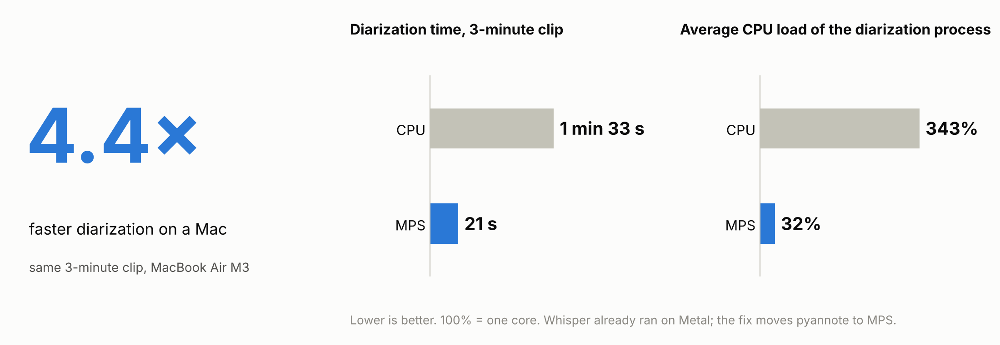

# Локальная транскрибация встреч на Mac: как ускорить диаризацию более чем в 4 раза

[English: README.md](README.md)

*Собрала конвейер для транскрибации у себя на ноутбуке, без облака. При первых прогонах он оказался медленным. Разбираю почему и как я его ускорила.*

> **TL;DR.** Конвейер из Whisper и pyannote на MacBook Air M3 обрабатывал 42-минутную встречу 2 ч 9 мин и сильно грузил ноутбук: в снимке процессов диаризация занимала 233% CPU, а FolderActionsDispatcher ещё 97%. Я упорядочила запуск: очередь, фоновый процесс, одна активная автоматизация, - и перенесла диаризацию pyannote с CPU на GPU. Диаризация одного и того же трёхминутного фрагмента ускорилась с **1 мин 33 с до 21 с (в 4,4 раза)**, а средняя загрузка CPU процессом диаризации упала с 343% до 32%. 42 минуты аудио теперь обрабатывается за 11 мин 19 с (RTF 0,27).



## 1. Зачем локально

Я записываю встречи и исследования и хотела получать текст с таймкодами и метками «кто говорит», чтобы потом анализировать его с помощью ИИ. Плюс было интересно самой настроить автоматизацию.

Почему не облачный сервис:

- **Чужие данные.** В записях бывают работодатели, цифры, иногда личное. Я не хочу загружать их в сторонний сервис без согласия всех участников.
- **Контроль формата.** Мне нужен один файл в том виде, в каком я с ним работаю дальше.
- **Стоимость при регулярном использовании.** Несколько встреч в неделю в облаке недорого, но постоянный поток часов уже заметен.

Готовое облачное решение часто быстрее и точнее, особенно в разметке спикеров, поэтому я не утверждаю, что локально лучше. Это решение под меня, и возможно, оно подойдёт кому-то со схожими задачами.

## 2. Что получилось

Кладу файл в папку Audio → система запрашивает число спикеров, указываю → через несколько минут получаю текстовый файл в папке Transcripts.

```text
Аудиофайл → папка Audio → Folder Action (Automator)
→ диалог: 1–20 спикеров / auto / Отмена
→ файлы обрабатываются по очереди
→ FFmpeg → WAV 16 кГц, mono
→ whisper.cpp medium (Metal) → текст + сегменты
→ pyannote community-1 → кто когда говорит
→ Transcripts/<имя>_diarized.txt
```

Язык определяется автоматически, без перевода: первая версия по умолчанию превращала русскую речь в английский текст.

```text
[00:00:12] Спикер 1: Какую задачу мы решаем?
[00:00:19] Спикер 2: Хотим сократить время ожидания транскрипта.
```

Распознавание и разметка спикеров идут на ноутбуке, аудио никуда не отправляется. Только первая установка и загрузка моделей требуют подключения к сети.

## 3. Проблема: распознавание быстрое, разметка спикеров — нет

Когда я начала прогонять через конвейер реальные встречи, оказалось, что транскрибация происходит относительно быстро, а диаризация идёт долго и сильно грузит ноутбук. Встреча на 42 минуты обрабатывалась 2 ч 9 мин, то есть втрое дольше самой записи. Для регулярной работы это слишком долго.

Снимок процессов во время обработки:

- диаризация держит **233% CPU** (около 2,3 ядра);
- FolderActionsDispatcher занимает **97,2% CPU**, почти ещё одно ядро.

Значит, проверять нужно было и расчёты, и автоматизацию. Начала с автоматизации.

## 4. Решение

### Автоматизация

Задачи организовала через последовательную очередь: пока обрабатывается одна запись, следующая ждёт. Для выбора спикеров и вычислений используются отдельные блокировки. Уже обработанную версию файла скрипт не берет.
Обработку вынесла из Folder Action в отдельный фоновый процесс через nohup. Так действие Automator завершается, не дожидаясь транскрибации.
Очередь проверилась на реальных файлах: вторая запись стартовала через секунду после завершения первой. Это защищает от одновременных тяжёлых запусков и повторной обработки готовых файлов.
После этих правок FolderActionsDispatcher в простое показывал 0% CPU. Вклад каждого действия отдельно я не измеряла: нагрузка снизилась в результате их совокупности.

### Диаризация на GPU

После автоматизации приступила к отладке диаризации. Python собран под `arm64`, MPS (GPU Apple) доступен, а в журнале видно, что Whisper работает через Metal, то есть на GPU. Но «MPS доступен» не значит, что им пользуется pyannote.

В скрипте диаризации не было ни одной строки, переносящей pipeline на GPU. PyTorch сам этого не делает, поэтому pyannote работала на CPU.

```python
device = torch.device("mps" if torch.backends.mps.is_available() else "cpu")
pipeline.to(device)
```

Плюс таймеры по этапам и запись выбранного устройства в журнал.

Проверяла по шагам: бэкап → CPU и MPS на одинаковых данных в отдельной папке → правка в рабочем скрипте → сквозной тест через папку → трёхминутный фрагмент → полная встреча. Короткий тест на 26 секунд показал, что MPS работает, но выигрыш там небольшой: на коротком файле время съедает загрузка моделей. Поэтому я довела проверку до длинных записей.

## 5. Результат

Все замеры сделаны на MacBook Air M3 (подробности в разделе 9).

**RTF (Real-Time Factor)** — время выбранного этапа, делённое на длительность аудио. Здесь отдельно показаны RTF диаризации и RTF всего конвейера. Чем меньше значение, тем быстрее обработка: RTF 1,0 — час на час записи, RTF 0,27 — около 16 минут на час записи.

**Один и тот же фрагмент 3 мин, автоопределение числа спикеров:**

| Метрика | CPU | MPS | Изменение |
| :---- | ----: | ----: | ----: |
| **Процесс диаризации, включая импорты** | 1 мин 33 с | **21 с** | **в 4,4× быстрее** |
| RTF диаризации (с импортами) | 0,52 | 0,12 | **−77,1%** |
| Вызов диаризации с чтением WAV | 1 мин 28 с | 17 с | **в 5,2× быстрее** |
| Средняя загрузка CPU процессом диаризации | 343% | 32% | **−91%** |
| Пиковая память процесса (RSS) | 3,8 GiB | 1,0 GiB | **−75%** |
| Расчётное время всего конвейера\* | 1 мин 59 с | 48 с | **в 2,5× быстрее** |
| **RTF всего конвейера\*** | **0,66** | **0,27** | **−60%** |

Весь конвейер ускорился в 2,5 раза, а не в 4,4: конвертация и Whisper не менялись и занимают в обоих вариантах те же ≈27 с, поэтому общее ускорение меньше, чем у самой диаризации.

\* Распознавание и конвертация запускались один раз, их время добавлено к обоим вариантам. 100% CPU = одно ядро. Значения округлены: время до секунды, остальное до десятых (RTF до сотых); коэффициенты, RTF и проценты посчитаны по неокруглённым значениям. Текст на выходе совпал до символа.

**Полная встреча 42 мин 16 с.** После исправления конвейер обрабатывает её за 11 мин 19 с (RTF 0,27): диаризация занимает 4 мин 47 с (RTF 0,11), Whisper 6 мин 28 с. Раньше та же запись обрабатывалась 2 ч 9 мин, но это запуск из старого журнала, а не контрольный замер: фоновая нагрузка не измерялась, а возможный сон не зафиксирован. Whisper, который я не меняла, тогда тоже работал дольше (9 мин 7 с), поэтому выделить из этой разницы вклад переноса на GPU нельзя. Текст совпал с прежним побайтово (242 строки).

Расчётный RTF трёхминутного фрагмента совпал с RTF полной встречи — 0,27. На коротком файле (27 с) процесс диаризации ускорился только в 1,6 раза (17 → 11 с).

## 6. Что я из этого вынесла

- **«GPU доступен» и «этап использует GPU» — разные утверждения.** В конвейере из нескольких моделей каждую надо проверять отдельно.
- **Логировать устройство и время каждого этапа**, иначе узкое место ищется по ощущениям.

## 7. Ограничения

- Один запуск на каждый вариант, разброс не оценивался.
- Не измерялись точность распознавания (WER) и разметки (DER): сравнивалось только совпадение результатов между запусками.
- Не измерялись энергопотребление и загрузка GPU.
- Снижение нагрузки FolderActionsDispatcher (97% в одном снимке, затем 0% в простое) — наблюдение, а не замер. Правки вносились вместе (очередь, фоновый процесс, одна активная автоматизация, перенос диаризации на GPU), вклад каждой отдельно не оценивался.
- Каждому сегменту Whisper назначается один спикер.
- Нет отката на CPU, если MPS выдаёт ошибку во время расчёта.
- Модель Whisper выбрана без сравнения с альтернативами.

## 8. Роль ИИ

Я работала с ИИ-ассистентами. **Я** ставила задачу и критерии удобства, проверяла результаты, подтверждала каждое изменение и длинные запуски. **Ассистент** читал журналы и код, предлагал гипотезы, готовил минимальную правку и бэкапы, считал замеры.
Черновик этого документа я собрала из своих заметок и документации к конвейеру, а ассистент помог выстроить логику, проверить ссылки, разложить материал по репозиторию и перевести на английский; числа сверялись с журналами и результатами замеров, наполнение и финальную версию утверждала я.

## 9. Окружение

MacBook Air M3 (8 ядер: 4+4), 16 GB, macOS 26.6.2, Python 3.11.18 (`arm64`), whisper.cpp 1.9.5 (`ggml-medium`), FFmpeg 9.0.2, torch 2.15.0, pyannote.audio 4.0.7 (`pyannote/speaker-diarization-community-1`). Версии на момент написания, не lockfile исторических запусков.

## 10. Как повторить

| Файл | Что это |
| :---- | :---- |
| [`docs/setup.md`](docs/setup.md) | Установка с нуля: Homebrew, Python, доступ к модели, Folder Action, проверка, типичные проблемы и повтор замеров |
| [`scripts/run_transcription.sh`](scripts/run_transcription.sh) | Точка входа для Folder Action: диалог спикеров, очередь, FFmpeg, Whisper, вызов диаризации |
| [`scripts/ask_speakers.applescript`](scripts/ask_speakers.applescript) | Диалог выбора числа спикеров |
| [`scripts/notify.applescript`](scripts/notify.applescript) | Уведомления macOS о ходе обработки |
| [`scripts/diarize.py`](scripts/diarize.py) | Диаризация на MPS/CPU с таймерами и назначение спикеров сегментам |
| [`bench/bench_diar.py`](bench/bench_diar.py) | Замер диаризации на CPU или MPS: время, RTF, память, результат в RTTM |
| [`bench/compare_rttm.py`](bench/compare_rttm.py) | Сравнение двух RTTM-файлов (DER): насколько совпадает разметка в двух прогонах |
| [`examples/sample_diarized.txt`](examples/sample_diarized.txt) | Пример вывода (синтетический диалог) |
| [`requirements.txt`](requirements.txt) | Прямые Python-зависимости; это не полный lockfile исторических замеров |
| [`LICENSE`](LICENSE) | Лицензия MIT на скрипты и документацию |
| [`NOTICE.md`](NOTICE.md) | Лицензии и атрибуция сторонних компонентов |

Числа замеров приведены в разделе 5 и в блоке «Для машин» ниже. Чтобы получить свои, запустите `bench/bench_diar.py` на трёхминутном фрагменте (команды в `docs/setup.md`, раздел «Повторить замеры»).

Скрипты в `scripts/` — рабочие версии, которыми я пользуюсь. `run_transcription.sh` запускается из действия Automator в фоне через `nohup`; команда для Automator приведена в `docs/setup.md`.

В репозитории только скрипты и документация: реальных записей и транскриптов нет. Модель community-1 распространяется под CC BY 4.0, атрибуция в `NOTICE.md`.

## 11. Статьи об этом проекте

- [vc.ru](https://vc.ru/id6131754/3246325-kak-uskorit-rasshifrovku-audio-na-mac-bez-oblaka): короткая версия для продактов и маркетологов.
- [dev.to](ССЫЛКА_НА_DEV_TO): техническая статья на английском.
- [Medium](https://kateglazkova.medium.com/how-i-made-local-transcription-4-4-faster-on-a-macbook-air-fa07c49ba8e8): та же история на английском.
---

## Для машин: структурированная сводка

Блок для поисковых систем, ИИ-агентов и автоматической обработки. Те же факты, что в тексте, без интерпретаций.

```yaml
case:
  title: "Локальная транскрибация встреч на Mac: как ускорить диаризацию более чем в 4 раза"
  language: ru
  type: [local-pipeline, performance-diagnosis]
  domain: [speech-to-text, speaker-diarization, apple-silicon]
  ai_assisted: true

goal: "локальный текст встреч с таймкодами и метками спикеров без отправки аудио в облако"
why_local: [privacy_of_participants, output_format_control, cost_at_volume]

pipeline:
  trigger: "macOS Folder Action на папку Audio"
  steps: [speaker_count_dialog, sequential_queue, ffmpeg_16khz_mono, whisper_cpp_medium_metal, pyannote_community_1, segment_speaker_assignment]
  output: "Transcripts/<name>_diarized.txt"

reproduce:
  setup: docs/setup.md
  entry_point: scripts/run_transcription.sh
  diarization: scripts/diarize.py
  speaker_dialog: scripts/ask_speakers.applescript
  notifications: scripts/notify.applescript
  benchmark_script: bench/bench_diar.py
  rttm_comparison: bench/compare_rttm.py
  example_output: examples/sample_diarized.txt
  license: "LICENSE (MIT)"
  notices: NOTICE.md
  benchmark_results: "раздел 5 README и блок benchmarks ниже"
  dependencies: "requirements.txt; direct requirements, not historical lock"

problem:
  symptom: "распознавание быстрое, диаризация долгая и грузит CPU"
  root_cause: "pyannote pipeline не был перенесён на MPS и работал на CPU; Whisper уже использовал Metal"

pre_mps_changes:
  automation: [sequential_queue, separate_dialog_lock, background_worker_nohup, skip_processed_versions]
  active_folder_actions: 1
  observed_effect: "FolderActionsDispatcher: 97.2% CPU в снимке, 0% в простое после правок"
  effect_attribution: "совокупность действий; вклад каждого отдельно не оценивался"

fix:
  file: scripts/diarize.py
  change: 'pipeline.to(torch.device("mps" if torch.backends.mps.is_available() else "cpu"))'
  added: [stage_timers, device_logging]

environment:
  hardware: "MacBook Air M3, 8 CPU cores (4P+4E), 16 GB RAM"
  os: "macOS 26.6.2"
  python: "3.11.18 arm64"
  whisper_cpp: "1.9.5, ggml-medium"
  torch: "2.15.0"
  pyannote_audio: "4.0.7"
  diarization_model: "pyannote/speaker-diarization-community-1"

benchmarks:
  controlled_180s_clip:
    runs_per_device: 1
    speakers: auto
    diarization_process_s: { cpu: 92.80, mps: 21.28, speedup: 4.36 }
    diarization_process_rtf: { cpu: 0.515577, mps: 0.118245 }
    diarization_inference_s: { cpu: 88.41, mps: 17.15, speedup: 5.16 }
    avg_cpu_load_pct: { cpu: 343, mps: 32 }
    peak_rss_gib: { cpu: 3.79, mps: 0.96 }
    pipeline_estimate_s: { cpu: 119.3, mps: 47.8 }
    pipeline_estimate_rtf: { cpu: 0.662734, mps: 0.265402 }
    outputs_identical: true
  short_clip_26s:
    audio_duration_s: 26.6
    diarization_process_s: { cpu: 16.67, mps: 10.60, speedup: 1.57 }
  historical_full_meeting:
    audio_duration: "42m16s"
    before_single_run: "2h09m08s"
    after: "11m19s"
    audio_duration_s: 2536.256
    pipeline_rtf: { before: 3.054897, after: 0.267709 }
    diarization_process_rtf: { before_estimate: 2.84, after: 0.113284 }
    whisper_internal_s: { before: 547.26025, after: 388.31241 }
    before_diarization_estimate_s: 7197
    before_diarization_estimate_method: process_age_snapshot_to_DONE
    before_diarization_estimate_note: "приблизительно; секундная точность не подтверждена"
    before_cpu_load_pct: null
    before_rss_gib: null
    outputs_identical: true
    note: "историческое сравнение; отдельный вклад MPS на полной записи не измерен"

not_measured: [WER, DER, variance, energy, gpu_utilization, automation_contribution]
limitations:
  - "один спикер на сегмент Whisper"
  - "нет отката на CPU при ошибке MPS"
  - "модель Whisper выбрана без сравнения альтернатив"
```
