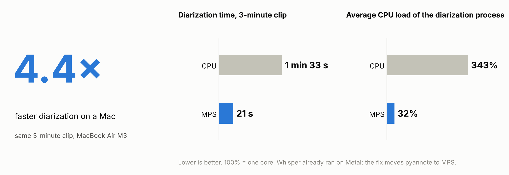

# Local meeting transcription on a Mac: how I sped up diarization more than 4×

*I built a transcription pipeline on my own laptop, with no cloud. On the first real runs it turned out to be slow. This is why, and how I sped it up.*

> **TL;DR.** The Whisper + pyannote pipeline on a MacBook Air M3 took 2 h 9 min to process a 42-minute meeting and loaded the laptop heavily: in a process snapshot diarization used 233% CPU and FolderActionsDispatcher another 97%. I put the launch in order: a queue, a background process, one active automation, and moved pyannote diarization from the CPU to the GPU. Diarization of the same 3-minute clip got faster from **1 min 33 s to 21 s (4.4×)**, and the average CPU load of the diarization process fell from 343% to 32%. 42 minutes of audio are now processed in 11 min 19 s (RTF 0.27).



[← Back to the README](../README.md) · [По-русски](../README.ru.md)

## 1. Why local

I record meetings and research interviews and wanted text with timestamps and "who is speaking" labels, so that I can analyse it with AI afterwards. I was also curious to set up the automation myself.

Why not a cloud service:

- **Other people's data.** Recordings contain employers, numbers, sometimes personal details. I do not want to upload them to a third-party service without the consent of every participant.
- **Control over the format.** I want one file in exactly the shape I work with next.
- **Cost at regular use.** A few meetings a week are cheap in the cloud, but a steady stream of hours adds up.

A ready-made cloud service is often faster and more accurate, especially at speaker labelling, so I am not claiming that local is better. This is a setup that fits me, and it may suit someone with a similar task.

## 2. What I ended up with

I drop a file into the Audio folder, the system asks for the number of speakers, I answer, and a few minutes later I get a text file in the Transcripts folder.

```text
Audio file → Audio folder → Folder Action (Automator)
→ dialog: 1–20 speakers / auto / Cancel
→ files are processed one at a time
→ FFmpeg → 16 kHz mono WAV
→ whisper.cpp medium (Metal) → text + segments
→ pyannote community-1 → who speaks when
→ Transcripts/<name>_diarized.txt
```

The language is detected automatically and nothing is translated: the first version turned Russian speech into English text by default.

```text
[00:00:12] Спикер 1: Какую задачу мы решаем?
[00:00:19] Спикер 2: Хотим сократить время ожидания транскрипта.
```

Transcription and diarization run on the laptop and the audio is not sent anywhere. Only the first installation and the model downloads need the network.

## 3. The problem: transcription is fast, speaker labelling is not

When I started running real meetings through the pipeline, transcription turned out to be relatively fast, while diarization took a long time and loaded the laptop heavily. A 42-minute meeting took 2 h 9 min, three times longer than the recording itself. That is too long for regular use.

A snapshot of the processes during a run:

- diarization holds **233% CPU** (about 2.3 cores);
- FolderActionsDispatcher uses **97.2% CPU**, almost another core.

So both the computation and the automation needed checking. I started with the automation.

## 4. The solution

### Automation

I set up a sequential queue: while one recording is processed, the next waits. The speaker-count dialogs and the computations use separate locks. A file version that was already processed is skipped.
I moved the processing out of the Folder Action into a separate background process via nohup. That way the Automator action finishes without waiting for transcription.

The queue was tested on real files: the second recording started one second after the first finished. This protects against several heavy jobs running at once and against reprocessing finished files. After these changes FolderActionsDispatcher showed 0% CPU when idle. I did not measure the contribution of each action separately: the load came down as a result of all of them together.

### Moving diarization to the GPU

After the automation, I started debugging the diarization. Python is built for `arm64`, MPS (Apple's GPU) is available, and the log shows that Whisper works through Metal, that is, on the GPU. But "MPS is available" does not mean pyannote uses it.

The diarization script had no line that moves the pipeline to the GPU. PyTorch does not do it by itself, so pyannote computed on the CPU.

```python
device = torch.device("mps" if torch.backends.mps.is_available() else "cpu")
pipeline.to(device)
```

Plus per-stage timers and a log line with the chosen device.

I checked it step by step: backup → CPU and MPS on identical data in a separate folder → the change in the working script → end-to-end test through the folder → a 3-minute clip → a full meeting. A short 26-second test showed that MPS works, but the gain there is small: on a short file, loading the models eats the time. So I took the check to long recordings.

## 5. Results

All measurements were made on a MacBook Air M3 (details in section 9).

**RTF (Real-Time Factor)** is the time of a given stage divided by the audio duration. Here RTF is shown separately for diarization and for the whole pipeline. Lower is faster: RTF 1.0 is an hour for an hour of recording, RTF 0.27 is about 16 minutes per hour of recording.

**The same 3-minute clip, number of speakers set to auto:**

| Metric | CPU | MPS | Change |
| :---- | ----: | ----: | ----: |
| **Diarization process, including imports** | 1 min 33 s | **21 s** | **4.4× faster** |
| Diarization RTF (with imports) | 0.52 | 0.12 | **−77.1%** |
| Diarization call, including WAV read | 1 min 28 s | 17 s | **5.2× faster** |
| Average CPU load of the diarization process | 343% | 32% | **−91%** |
| Peak process memory (RSS) | 3.8 GiB | 1.0 GiB | **−75%** |
| Estimated whole pipeline\* | 1 min 59 s | 48 s | **2.5× faster** |
| **Whole pipeline RTF\*** | **0.66** | **0.27** | **−60%** |

The whole pipeline got 2.5× faster, not 4.4×: conversion and Whisper did not change and take the same ≈27 s in both variants, so the overall speed-up is smaller than that of diarization itself.

\* Transcription and conversion ran once; their time is added to both variants. 100% CPU is one core. Values are rounded: time to the second, other numbers to tenths (RTF to hundredths); ratios, RTF and percentages are computed from unrounded values. The text output was identical to the character.

**Full 42 min 16 s meeting.** After the fix the pipeline processes it in 11 min 19 s (RTF 0.27): diarization takes 4 min 47 s (RTF 0.11) and Whisper 6 min 28 s. The same recording used to take 2 h 9 min, but that is a run from an old log, not a controlled measurement: background load was not measured and possible sleep was not recorded. Whisper, which I did not change, was also slower then (9 min 7 s), so the contribution of the GPU move cannot be separated out from this difference. The text matched the earlier output byte for byte (242 lines).

The estimated RTF of the 3-minute clip matches that of the full meeting: 0.27. On the short file (27 s) diarization sped up only 1.6× (17 → 11 s).

## 6. What I took from this

- **"The GPU is available" and "this stage uses the GPU" are different statements.** In a pipeline of several models, each one has to be checked separately.
- **Log the device and the time of every stage**, otherwise the bottleneck is found by feel.

## 7. Limitations

- One run per variant; the spread was not estimated.
- Word error rate (WER) and diarization error rate (DER) were not measured: only the agreement of results between runs was compared.
- Energy use and GPU utilization were not measured.
- The CPU-load drop of the Folder Action dispatcher (97% in one snapshot, then 0% when idle) is an observation, not a measurement. The changes were made together (queue, background process, one active automation, moving diarization to the GPU) and the contribution of each was not assessed.
- Each Whisper segment gets a single speaker.
- There is no fallback to the CPU if MPS raises an error during the computation.
- The Whisper model was chosen without comparing alternatives.

## 8. The role of AI

I worked with AI assistants. **I** set the task and the usability criteria, checked the results and approved every change and every long run. **The assistant** read logs and code, proposed hypotheses, prepared a minimal patch and backups, and computed the measurements.
I put the first draft of this document together from my own notes and the pipeline documentation, and the assistant helped me structure the argument, check the links, lay the material out in the repository and translate it into English; the numbers were checked against the logs and measurement results, and I approved the content and the final version.

## 9. Environment

MacBook Air M3 (8 cores: 4+4), 16 GB, macOS 26.6.2, Python 3.11.18 (`arm64`), whisper.cpp 1.9.5 (`ggml-medium`), FFmpeg 9.0.2, torch 2.15.0, pyannote.audio 4.0.7 (`pyannote/speaker-diarization-community-1`). Versions at the time of writing, not a lockfile of the historical runs.

## 10. How to reproduce

| File | What it is |
| :---- | :---- |
| [`setup.md`](setup.md) | Setup from scratch (in Russian): Homebrew, Python, model access, Folder Action, checks, common problems, repeating the measurements |
| [`../scripts/run_transcription.sh`](../scripts/run_transcription.sh) | Folder Action entry point: speaker dialog, queue, FFmpeg, Whisper, diarization call |
| [`../scripts/ask_speakers.applescript`](../scripts/ask_speakers.applescript) | Dialog for the number of speakers |
| [`../scripts/notify.applescript`](../scripts/notify.applescript) | macOS notifications about progress |
| [`../scripts/diarize.py`](../scripts/diarize.py) | Diarization on MPS/CPU with timers, and assigning speakers to segments |
| [`../bench/bench_diar.py`](../bench/bench_diar.py) | Diarization timing on CPU or MPS: time, RTF, memory, RTTM output |
| [`../bench/compare_rttm.py`](../bench/compare_rttm.py) | Comparing two RTTM files (DER): how much the labelling differs between two runs |
| [`../examples/sample_diarized.txt`](../examples/sample_diarized.txt) | Example output (a synthetic dialogue) |
| [`../requirements.txt`](../requirements.txt) | Direct Python dependencies; not a full lockfile of the historical measurements |
| [`../LICENSE`](../LICENSE) | MIT licence for the scripts and documentation |
| [`../NOTICE.md`](../NOTICE.md) | Licences and attribution of third-party components |

The measurement numbers are in section 5 and in the "For machines" block below. To get your own, run `bench/bench_diar.py` on a 3-minute clip (commands in `docs/setup.md`, section "Повторить замеры").

The scripts in `scripts/` are the working versions I use. `run_transcription.sh` is started from the Automator action in the background via `nohup`; the command is given in `docs/setup.md`.

The repository holds scripts and documentation only: no real recordings or transcripts. The community-1 model is distributed under CC BY 4.0; attribution is in `NOTICE.md`.

---

## For machines: structured summary

A block for search engines, AI agents and automated processing. The same facts as in the text, without interpretation.

```yaml
case:
  title: "Local meeting transcription on a Mac: how I sped up diarization more than 4x"
  language: en
  type: [local-pipeline, performance-diagnosis]
  domain: [speech-to-text, speaker-diarization, apple-silicon]
  ai_assisted: true

goal: "local meeting text with timestamps and speaker labels, without sending audio to the cloud"
why_local: [privacy_of_participants, output_format_control, cost_at_volume]

pipeline:
  trigger: "macOS Folder Action on the Audio folder"
  steps: [speaker_count_dialog, sequential_queue, ffmpeg_16khz_mono, whisper_cpp_medium_metal, pyannote_community_1, segment_speaker_assignment]
  output: "Transcripts/<name>_diarized.txt"

reproduce:
  setup: docs/setup.md
  entry_point: scripts/run_transcription.sh
  diarization: scripts/diarize.py
  speaker_dialog: scripts/ask_speakers.applescript
  notifications: scripts/notify.applescript
  benchmark_script: bench/bench_diar.py
  rttm_comparison: bench/compare_rttm.py
  example_output: examples/sample_diarized.txt
  license: "LICENSE (MIT)"
  notices: NOTICE.md
  benchmark_results: "section 5 of this document and the benchmarks block below"
  dependencies: "requirements.txt; direct requirements, not historical lock"

problem:
  symptom: "transcription is fast, diarization is slow and loads the CPU"
  root_cause: "the pyannote pipeline was not moved to MPS and ran on the CPU; Whisper already used Metal"

pre_mps_changes:
  automation: [sequential_queue, separate_dialog_lock, background_worker_nohup, skip_processed_versions]
  active_folder_actions: 1
  observed_effect: "FolderActionsDispatcher: 97.2% CPU in a snapshot, 0% when idle after the changes"
  effect_attribution: "the set of actions together; contribution of each not assessed"

fix:
  file: scripts/diarize.py
  change: 'pipeline.to(torch.device("mps" if torch.backends.mps.is_available() else "cpu"))'
  added: [stage_timers, device_logging]

environment:
  hardware: "MacBook Air M3, 8 CPU cores (4P+4E), 16 GB RAM"
  os: "macOS 26.6.2"
  python: "3.11.18 arm64"
  whisper_cpp: "1.9.5, ggml-medium"
  torch: "2.15.0"
  pyannote_audio: "4.0.7"
  diarization_model: "pyannote/speaker-diarization-community-1"

benchmarks:
  controlled_180s_clip:
    runs_per_device: 1
    speakers: auto
    diarization_process_s: { cpu: 92.80, mps: 21.28, speedup: 4.36 }
    diarization_process_rtf: { cpu: 0.515577, mps: 0.118245 }
    diarization_inference_s: { cpu: 88.41, mps: 17.15, speedup: 5.16 }
    avg_cpu_load_pct: { cpu: 343, mps: 32 }
    peak_rss_gib: { cpu: 3.79, mps: 0.96 }
    pipeline_estimate_s: { cpu: 119.3, mps: 47.8 }
    pipeline_estimate_rtf: { cpu: 0.662734, mps: 0.265402 }
    outputs_identical: true
  short_clip_26s:
    audio_duration_s: 26.6
    diarization_process_s: { cpu: 16.67, mps: 10.60, speedup: 1.57 }
  historical_full_meeting:
    audio_duration: "42m16s"
    before_single_run: "2h09m08s"
    after: "11m19s"
    audio_duration_s: 2536.256
    pipeline_rtf: { before: 3.054897, after: 0.267709 }
    diarization_process_rtf: { before_estimate: 2.84, after: 0.113284 }
    whisper_internal_s: { before: 547.26025, after: 388.31241 }
    before_diarization_estimate_s: 7197
    before_diarization_estimate_method: process_age_snapshot_to_DONE
    before_diarization_estimate_note: "approximate; to-the-second accuracy not confirmed"
    before_cpu_load_pct: null
    before_rss_gib: null
    outputs_identical: true
    note: "historical comparison; the separate contribution of MPS on the full recording was not measured"

not_measured: [WER, DER, variance, energy, gpu_utilization, automation_contribution]
limitations:
  - "one speaker per Whisper segment"
  - "no fallback to CPU on an MPS error"
  - "the Whisper model was chosen without comparing alternatives"
```
